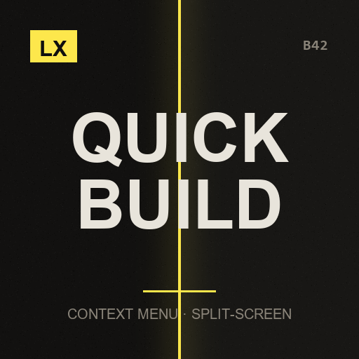

# LX Split-Screen Quick Build

**B41-style building menu, because B42's window does not fit**

> B42's build window is wider than half a screen. In split-screen you simply cannot use it. This puts building back in the context menu.

`Project Zomboid B42.21+` · `v1.1.0` · `CC0`

[English](#english) · [Español](#español) · [Русский](#русский)

---

## English

This mod is part of the **LX Split-Screen Suite**, seven mods that make Project Zomboid B42 playable in 2–4 player couch co-op, with or without a gamepad. Each one stands alone — install only what you need.

### Why split-screen?

Split-screen is the mode that carries the most bugs in stable B42 — and the mods worth playing with, like Bandits and Project A-Life, are built for singleplayer and online multiplayer. Nobody is fixing couch co-op. This suite exists to close that gap: to make split-screen as playable as the modes that get the attention.

### Why gamepad?

B42 keeps improving controller support, but it is still rough, and the aim-and-shoot rework left gunplay on a gamepad close to unusable — you cannot even shoot a zombie lying on the ground. Split-screen *with* a gamepad is the worst case the game offers. These mods give PZ back an aim that was designed for a stick: assist on the vertical axis, B41-style lock-on, per-player aim state, and a lot more.

### What it does

- **Build from the context menu** — Right click the world, or press the context-menu button on a controller, and pick **Quick build**. No window, no scrolling, no viewport problem.
- **Everything that matters, grouped** — Walls, frames, doors, floors, fences and stairs in wood (Carpentry), metal (Metalworking) and brick/stone (Masonry), plus Furniture and Outdoors. Categories with many recipes are split into subgroups — walls, doors and gates, floors, stairs, seating, storage and so on — and each heading shows how many of its recipes you can build right now.
- **Tooltips that answer the question** — Each entry shows the skill it needs and your level, whether the recipe still has to be learned from a book, every material and tool with how much you are carrying versus how much it takes, in green or red. You know why something is greyed out without opening anything.
- **Same engine as the vanilla window** — It drives the game's own `BuildLogic` and placement cursor, so skill checks, recipe validity, material consumption and the build action itself are identical to vanilla. It is the interface that changes, not the rules.
- **Keeps building** — After you place a piece the cursor stays armed for the next one, like B41. B cancels. D-pad moves, LB/RB rotate, A builds.

### Requirements

None. Vanilla B42.21 is enough.

### Installing

**From the Steam Workshop (recommended)**
Subscribe on the Workshop page. Steam downloads it; then start Project Zomboid, go to
**Mods** in the main menu and enable it. In split-screen, enabling it once covers all players.

**Manually**
1. Download this repository (green **Code** button -> **Download ZIP**) and unzip it.
2. Copy the folder `LX_SPLITSCREEN_CONTEXTMENU_BUILDING` into your Zomboid mods folder:
   - Windows: `C:\Users\<you>\Zomboid\mods\`
   - Linux: `~/Zomboid/mods/`
   - macOS: `~/Library/Application Support/Zomboid/mods/`
   The result must be `...\Zomboid\mods\LX_SPLITSCREEN_CONTEXTMENU_BUILDING\42\mod.info`.
3. Start the game, open **Mods** in the main menu and enable **LX Split-Screen Quick Build**.

### Options

Options → MODS → **LX Split-Screen Quick Build**. Show or hide the menu, and show or hide the available/total counters.

### Notes

- Does not remove or replace B42's build window — it is still there if you want it.
- Recipes with no placeable object (vanilla has a couple that are broken) are skipped and noted in `console.txt`.
- Works on mouse and controller, in split-screen and in normal singleplayer.

### License

**CC0 1.0 Universal** — public domain dedication. Do whatever you want with it: copy it, change it, put it in a modpack, publish it, sell it. No permission needed, no credit required (though it is always welcome). See `LICENSE`.

### Support

If these mods made your co-op run work, you can buy me a coffee — [ko-fi.com/litoxperaloca](https://ko-fi.com/litoxperaloca)

### The rest of the suite

- [LX Coop Fixes](https://github.com/litoxperaloca/LX_CoopFixes) — Split-screen stability: vehicle crash, player 2 aiming, map stutter, error spam.
- [LX Split Aim](https://github.com/litoxperaloca/LX_SplitAim) — Controller aim assist and B41-style lock-on, per local player.
- [LX A-Life Split-Screen Fix](https://github.com/litoxperaloca/LX_ALifeSplit) — Project A-Life NPCs react to every local player, not just player 1.
- [LX Bandits Split-Screen Fix](https://github.com/litoxperaloca/LX_BanditsSplit) — Bandits target the right player, companions follow who recruited them.
- [LX Split-Screen Welcome Package](https://github.com/litoxperaloca/LX_SPLITSCREEN_WELCOME_PACKAGE) — A configurable starter kit per local character.
- [LX Split-Screen Skills Boost](https://github.com/litoxperaloca/LX_SPLITSCREEN_SKILLS_IMPROVE) — A configurable skill floor per local character.
- [LX Theodore Split-Screen Fix](https://github.com/litoxperaloca/LX_TheodoreSplit) — Theodore, the family NPC, reacts to every local player and works with a gamepad.
- [LX NPC Bases Split-Screen Fix](https://github.com/litoxperaloca/LX_NPCBasesSplit) — Bandit settlements open on your half of the screen, take a gamepad, and keep appearing as you travel.

---

## Español

> La ventana de construcción de B42 es más ancha que media pantalla. En pantalla dividida directamente no se puede usar. Esto devuelve la construcción al menú contextual.

Este mod es parte de la **LX Split-Screen Suite**, siete mods que hacen jugable Project Zomboid B42 en coop de sillón de 2 a 4 jugadores, con o sin mando. Cada uno funciona por separado — instalá solo lo que precises.

### ¿Por qué pantalla dividida?

Es la modalidad con más bugs en la B42 estable — y los mods que valen la pena, como Bandits y Project A-Life, están pensados para un jugador y multijugador online. Nadie arregla el coop de sillón. Esta suite existe para cerrar esa brecha: dejar la pantalla dividida a la par de las modalidades que sí reciben atención.

### ¿Por qué mando?

La B42 viene mejorando el soporte de mando, pero todavía deja mucho que desear, y el rework de apuntado y disparo dejó el tiroteo con mando casi imposible — ni siquiera podés dispararle a un zombi en el suelo. Pantalla dividida *con* mando es el peor escenario posible del juego. Estos mods le devuelven a PZ un apuntado pensado para stick: asistencia en el eje vertical, fijado de blanco estilo B41, estado de apuntado por jugador, y bastante más.

### Qué hace

- **Construir desde el menú contextual** — Clic derecho en el mundo, o el botón de menú contextual del mando, y elegís **Construcción rápida**. Sin ventana, sin scroll, sin problema de viewport.
- **Todo lo que importa, agrupado** — Paredes, marcos, puertas, pisos, cercas y escaleras en madera (Carpintería), metal (Metalistería) y ladrillo/piedra (Albañilería), más Muebles y Exterior. Las categorías con muchas recetas se parten en subgrupos — paredes, puertas y portones, pisos, escaleras, asientos, almacenamiento — y cada encabezado muestra cuántas de sus recetas podés construir ahora mismo.
- **Tooltips que contestan la pregunta** — Cada entrada muestra la habilidad que pide y tu nivel, si la receta todavía hay que aprenderla de un libro, y cada material y herramienta con cuánto llevás contra cuánto hace falta, en verde o rojo. Sabés por qué algo está gris sin abrir nada.
- **El mismo motor que la ventana vanilla** — Usa el `BuildLogic` y el cursor de colocación del propio juego, así que los chequeos de habilidad, la validez de la receta, el consumo de materiales y la acción de construir son idénticos a vanilla. Cambia la interfaz, no las reglas.
- **Sigue construyendo** — Después de colocar una pieza el cursor queda armado para la siguiente, como en B41. B cancela. La cruceta mueve, LB/RB rotan, A construye.

### Requisitos

Ninguno. Alcanza con B42.21 vanilla.

### Instalación

**Desde el Steam Workshop (recomendado)**
Suscribite en la página del Workshop. Steam lo descarga solo; después abrí Project Zomboid,
andá a **Mods** en el menú principal y activalo. En pantalla dividida, con activarlo una vez
alcanza para todos los jugadores.

**A mano**
1. Descargá este repositorio (botón verde **Code** -> **Download ZIP**) y descomprimilo.
2. Copiá la carpeta `LX_SPLITSCREEN_CONTEXTMENU_BUILDING` a tu carpeta de mods de Zomboid:
   - Windows: `C:\Users\<vos>\Zomboid\mods\`
   - Linux: `~/Zomboid/mods/`
   - macOS: `~/Library/Application Support/Zomboid/mods/`
   Tiene que quedar `...\Zomboid\mods\LX_SPLITSCREEN_CONTEXTMENU_BUILDING\42\mod.info`.
3. Abrí el juego, entrá a **Mods** en el menú principal y activá **LX Split-Screen Quick Build**.

### Opciones

Opciones → MODS → **LX Pantalla dividida: construcción rápida**. Mostrar u ocultar el menú, y mostrar u ocultar los contadores disponibles/total.

### Notas

- No saca ni reemplaza la ventana de construcción de B42 — sigue estando si la querés usar.
- Las recetas sin objeto colocable (vanilla tiene un par rotas) se omiten y se anotan en `console.txt`.
- Funciona con mouse y con mando, en pantalla dividida y en un jugador normal.

### Licencia

**CC0 1.0 Universal** — dedicado al dominio público. Hacé lo que quieras: copialo, cambialo, metélo en un modpack, publicalo, vendelo. No hace falta permiso ni crédito (aunque siempre se agradece). Ver `LICENSE`.

### Apoyar

Si estos mods te arreglaron el coop, podés invitarme un café — [ko-fi.com/litoxperaloca](https://ko-fi.com/litoxperaloca)

### El resto de la suite

- [LX Coop Fixes](https://github.com/litoxperaloca/LX_CoopFixes) — Estabilidad en pantalla dividida: crash de vehículos, apuntado del jugador 2, tirones del mapa, spam de errores.
- [LX Split Aim](https://github.com/litoxperaloca/LX_SplitAim) — Asistencia de apuntado con mando y fijado de blanco estilo B41, por jugador local.
- [LX A-Life Split-Screen Fix](https://github.com/litoxperaloca/LX_ALifeSplit) — Los NPCs de Project A-Life reaccionan a todos los jugadores locales, no solo al 1.
- [LX Bandits Split-Screen Fix](https://github.com/litoxperaloca/LX_BanditsSplit) — Los bandidos apuntan al jugador correcto, los compañeros siguen a quien los reclutó.
- [LX Split-Screen Welcome Package](https://github.com/litoxperaloca/LX_SPLITSCREEN_WELCOME_PACKAGE) — Un equipo inicial configurable por personaje local.
- [LX Split-Screen Skills Boost](https://github.com/litoxperaloca/LX_SPLITSCREEN_SKILLS_IMPROVE) — Un piso de habilidades configurable por personaje local.
- [LX Theodore Split-Screen Fix](https://github.com/litoxperaloca/LX_TheodoreSplit) — Theodore, el NPC familiar, reacciona a todos los jugadores locales y anda con mando.
- [LX NPC Bases Split-Screen Fix](https://github.com/litoxperaloca/LX_NPCBasesSplit) — Los asentamientos de bandidos se abren en tu mitad de pantalla, andan con mando, y siguen apareciendo mientras viajas.

---

## Русский

> Окно строительства B42 шире половины экрана. При разделённом экране им просто нельзя пользоваться. Это возвращает строительство в контекстное меню.

Этот мод входит в набор **LX Split-Screen Suite** — семь модов, которые делают Project Zomboid B42 играбельным в совместной игре на диване для 2–4 человек, с геймпадом или без. Каждый работает сам по себе — ставьте только нужное.

### Почему разделённый экран?

Разделённый экран — режим с наибольшим числом ошибок в стабильной B42, а моды, ради которых стоит играть, вроде Bandits и Project A-Life, сделаны под одиночную игру и сетевой мультиплеер. Совместной игрой на диване не занимается никто. Этот набор существует, чтобы закрыть пробел: сделать разделённый экран таким же играбельным, как режимы, которым достаётся внимание.

### Почему геймпад?

B42 продолжает улучшать поддержку контроллеров, но она всё ещё сырая, а переработка прицеливания и стрельбы сделала перестрелки с геймпада почти невозможными — вы даже не можете выстрелить в зомби, лежащего на полу. Разделённый экран *вместе* с геймпадом — худший случай, который предлагает игра. Эти моды возвращают PZ прицеливание, рассчитанное на стик: помощь по вертикальной оси, захват цели в стиле B41, отдельное состояние прицеливания для каждого игрока и многое другое.

### Что делает

- **Строить из контекстного меню** — Правый клик по миру или кнопка контекстного меню на геймпаде — и выбираете **Быстрое строительство**. Ни окна, ни прокрутки, ни проблем с размером экрана.
- **Всё нужное, по группам** — Стены, проёмы, двери, полы, заборы и лестницы из дерева (Плотничество), металла (Металлообработка) и кирпича или камня (Каменная кладка), плюс Мебель и Улица. Категории с большим числом рецептов разбиты на подгруппы, и каждый заголовок показывает, сколько его рецептов вы можете построить прямо сейчас.
- **Подсказки, которые отвечают на вопрос** — У каждого пункта видно нужный навык и ваш уровень, нужно ли ещё изучить рецепт по книге, а также каждый материал и инструмент с тем, сколько у вас есть против того, сколько требуется, зелёным или красным. Вы понимаете, почему пункт недоступен, ничего не открывая.
- **Тот же движок, что и у обычного окна** — Используется собственный `BuildLogic` игры и её курсор размещения, поэтому проверки навыков, валидность рецепта, расход материалов и само действие строительства идентичны обычным. Меняется интерфейс, а не правила.
- **Продолжает строить** — После установки детали курсор остаётся готовым к следующей, как в B41. B отменяет. Крестовина перемещает, LB/RB поворачивают, A строит.

### Требования

Нет. Достаточно обычной B42.21.

### Установка

**Из Steam Workshop (рекомендуется)**
Подпишитесь на странице Workshop. Steam скачает мод сам; затем запустите Project Zomboid,
откройте **Моды** в главном меню и включите его. При разделённом экране достаточно включить
один раз — это работает для всех игроков.

**Вручную**
1. Скачайте этот репозиторий (зелёная кнопка **Code** -> **Download ZIP**) и распакуйте.
2. Скопируйте папку `LX_SPLITSCREEN_CONTEXTMENU_BUILDING` в папку модов Zomboid:
   - Windows: `C:\Users\<вы>\Zomboid\mods\`
   - Linux: `~/Zomboid/mods/`
   - macOS: `~/Library/Application Support/Zomboid/mods/`
   Должно получиться `...\Zomboid\mods\LX_SPLITSCREEN_CONTEXTMENU_BUILDING\42\mod.info`.
3. Запустите игру, откройте **Моды** в главном меню и включите **LX Split-Screen Quick Build**.

### Настройки

Настройки → МОДЫ → **LX Разделённый экран: быстрое строительство**. Показывать или скрывать меню, показывать или скрывать счётчики доступно/всего.

### Примечания

- Не убирает и не заменяет окно строительства B42 — оно остаётся на месте, если вам удобнее им пользоваться.
- Рецепты без размещаемого объекта (в игре есть пара сломанных) пропускаются с записью в `console.txt`.
- Работает с мышью и с геймпадом, при разделённом экране и в обычной одиночной игре.

### Лицензия

**CC0 1.0 Universal** — передано в общественное достояние. Делайте что угодно: копируйте, изменяйте, включайте в сборки модов, публикуйте, продавайте. Разрешение не требуется, указание авторства не обязательно (но всегда приятно). См. `LICENSE`.

### Поддержать

Если эти моды помогли вашей совместной игре, можете угостить меня кофе — [ko-fi.com/litoxperaloca](https://ko-fi.com/litoxperaloca)

### Остальные моды набора

- [LX Coop Fixes](https://github.com/litoxperaloca/LX_CoopFixes) — Стабильность разделённого экрана: вылет транспорта, прицеливание второго игрока, подтормаживания карты.
- [LX Split Aim](https://github.com/litoxperaloca/LX_SplitAim) — Помощь прицеливания с геймпада и захват цели в стиле B41 для каждого локального игрока.
- [LX A-Life Split-Screen Fix](https://github.com/litoxperaloca/LX_ALifeSplit) — NPC из Project A-Life реагируют на всех локальных игроков, а не только на первого.
- [LX Bandits Split-Screen Fix](https://github.com/litoxperaloca/LX_BanditsSplit) — Бандиты целятся в нужного игрока, напарники следуют за тем, кто их нанял.
- [LX Split-Screen Welcome Package](https://github.com/litoxperaloca/LX_SPLITSCREEN_WELCOME_PACKAGE) — Настраиваемый стартовый набор для каждого локального персонажа.
- [LX Split-Screen Skills Boost](https://github.com/litoxperaloca/LX_SPLITSCREEN_SKILLS_IMPROVE) — Настраиваемый минимальный уровень навыков для каждого локального персонажа.
- [LX Theodore Split-Screen Fix](https://github.com/litoxperaloca/LX_TheodoreSplit) — Theodore реагирует на всех локальных игроков и работает с геймпадом.
- [LX NPC Bases Split-Screen Fix](https://github.com/litoxperaloca/LX_NPCBasesSplit) — Поселения бандитов открываются на вашей половине экрана, работают с геймпадом и продолжают появляться по мере путешествия.

